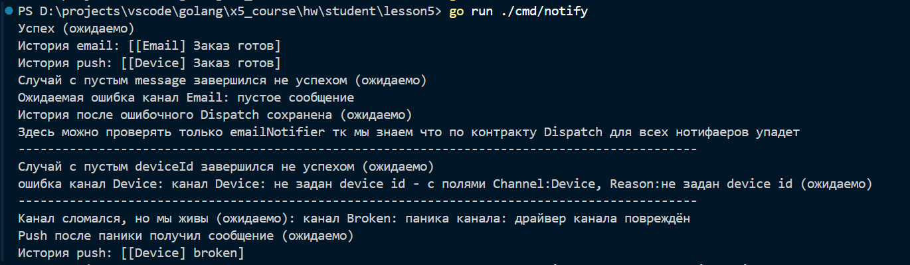

# Сервис уведомлений

Автор: Стрельцов Глеб

## Что делает программа

Учебная программа отправляет сообщения через email- и push-каналы с общим интерфейсом `Notifier`. Вместо настоящей отправки сообщение с префиксом канала добавляется в его историю `Messages`. На этих каналах показана обработка обычных ошибок и паники одной из реализаций.

## Как запустить

Команды выполняются из папки `lesson5`, в которой находится `go.mod`. Модуль рассчитан на Go 1.22 и выше, проверено на Go 1.27.2.

Из корня репозитория:

```bash
cd lesson5
go run ./cmd/notify
```

В `cmd/notify/main.go` случай выбирается значением переменной `scenario`:

- `1` — успешная отправка;
- `2` — пустой текст;
- `3` — нет настройки;
- `4` — сломанная реализация;
- `5` — все случаи, это значение стоит по умолчанию.

Для отдельного запуска нужно изменить значение `scenario` и снова выполнить команду запуска.

Проверка тестов, сборки и статический анализ:

```bash
go test ./...
go build ./...
go vet ./...
```

## Проверенные случаи

1. **Успех.** Email с адресом и push с DeviceID получают сообщение `Заказ готов` через `Dispatch`. Ошибки нет, в историях появляются `[Email] Заказ готов` и `[Device] Заказ готов`.
2. **Пустой текст.** После заполнения истории вызывается `Dispatch` с `""`. Через `errors.Is` распознаётся `ErrEmptyMessage`. История email сохраняется (ожидаемо), до push вызов не доходит: `Dispatch` останавливается на первой ошибке.
3. **Нет настройки.** Push без DeviceID получает непустое сообщение. Через `errors.As` извлекается `*SendError` с полями `Channel: "Device"` и `Reason: "не задан device id"`. Сообщение в историю не добавляется.
4. **Сломанная реализация.** В `SafeDispatch` сначала передаётся `BrokenNotifier`, затем исправный push. Паника становится ошибкой с `ErrNotifierPanic`, которая распознаётся через `errors.Is`. Канал сломался, но мы живы (ожидаемо): следующий push получает сообщение `broken`, в его истории появляется `[Device] broken`. Специально подписал в принтах ожидаемые результаты

Как можно видеть программа работает ожидаемо и корректно обрабатывает все эти случаи

## Обработка ошибок

`Dispatch` последовательно вызывает каналы и останавливается на первой ошибке. Он возвращает одну ошибку, добавляя имя канала через `fmt.Errorf` с `%w`, поэтому исходную причину можно найти через обёртку.

`SafeDispatch` вызывает каждый канал через `SafeSend`, продолжает работу после обычных ошибок и паник и возвращает слайс всех ошибок. Если ошибок нет, длина слайса равна нулю.

В функциях сценариев, вызываемых из `main`, используются:

- `errors.Is` — в `showEmptyMessage` для проверки `ErrEmptyMessage` и в `showBrokenNotifier` для проверки `ErrNotifierPanic`;
- `errors.As` — в `showMissingConfig` для извлечения `*SendError` и чтения его полей `Channel` и `Reason`.

`recover` вызывается внутри отложенной функции в `SafeSend`, которая оборачивает отдельный вызов `Send`. После перехвата паники `SafeSend` возвращает ошибку, и цикл в `SafeDispatch` переходит к следующему каналу. Если ловить панику одним `defer` вокруг всего цикла, после её перехвата функция завершится: выполнение с прерванной итерации не продолжится.
